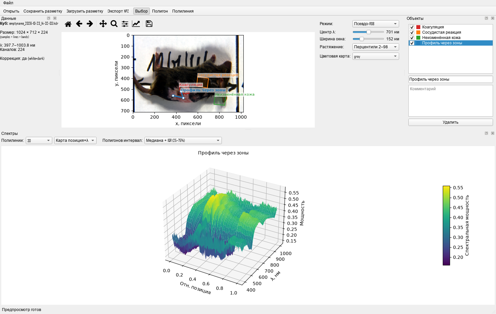

# hsi-toolkit

Настольное приложение (PySide6 + matplotlib) для визуализации и анализа
гиперспектральных кубов (ENVI HDR/RAW, BSQ/BIL/BIP) с векторной разметкой
полигонов и полилиний.



## Возможности

- **Загрузка набора данных**: куб + белый/тёмный референсы (опционально) +
  JSON-разметка. Автопоиск референсов `WHITEREF_*` / `DARKREF_*` рядом с кубом
  или в `capture/`. Куб остаётся на диске (memmap); референсы сводятся к
  профилям «среднее по строкам» `dark_prof[b, x]` / `white_prof[b, x]`
  (компенсация неравномерности засветки вдоль скана, как
  `bw_correction_broadcast_axis` из исследовательских ноутбуков).
- **Предпросмотр**: псевдо-RGB (ближайшие каналы к 650/550/450 нм) или
  спектральное окно (центр/ширина слайдерами), растяжение перцентили/min-max,
  цветовые карты. При открытии строится уменьшенный corrected-куб (×4) —
  перерисовка мгновенная; координаты разметки — всегда полноразмерные пиксели.
- **Разметка**: полигоны (`PolygonSelector`) и полилинии (свой инструмент:
  клик — вершина, перетаскивание — правка, Backspace — удалить последнюю,
  Enter/двойной клик — завершить, Esc — отмена). Имя, комментарий, цвет
  (tab10), видимость; мультивыбор в списке. Подписи зон на предпросмотре
  включаются галочкой «Подписи зон» с регулировкой размера шрифта.
- **Спектры**: полигоны → медиана + доверительный интервал (IQR 25–75 по
  умолчанию, 2.5–97.5 или mean±3σ) одним графиком, свой цвет на объект;
  полилинии → 3D-поверхность (позиция × λ) или водопад (карта/трассы),
  подграфик на линию. Спектры считаются по полному разрешению.
  Над графиками — навигационная панель matplotlib (панорама, зум, домой,
  сохранение графика в файл).
- **Статистика** (вкладка в нижнем доке): попарные сравнения видимых
  полигонов-ROI по каждому каналу — ΔR, ΔR/R эталона (%), медианы и ΔR медиан,
  Cohen's d, Mann–Whitney U или t-тест Уэлча, AUC ROC (U₁/(n₁·n₂)), поправка на
  множественные сравнения (Холм / FDR Бенджамини–Хохберга / без) на всю семью
  (каналы × пары), α = 0.05/0.01/0.001. Таблица «каналы × пары» со
  значимыми ячейками (p_adj < α) подсвеченными фоном; тултип ячейки — полный
  набор метрик. Выбор эталонной зоны (по умолчанию первая); экспорт CSV
  (utf-8-sig) и XLSX. Значения берутся из `working_band` (corrected при
  наличии референсов, иначе raw) — те же, что в панели «Спектры».
  Пиксели внутри полигона считаются независимыми выборками: пространственная
  автокорреляция завышает значимость.
- **Сохранение/загрузка разметки**: JSON `hsi-toolkit.annotations/1`, по
  умолчанию `<куб>.annotations.json`.
- **Экспорт NPZ**: участки изображения + маски — полигон → bbox-вырезка куба
  `(B, H, W)` + булева маска `(H, W)`; полилиния → лента `(B, S, width)` +
  относительные позиции `(S,)`; плюс `wavelengths` и JSON `objects`
  (id/kind/name/comment/color/points/bbox). Выбор объектов и corrected/raw в
  диалоге.

## Запуск

```powershell
uv run hsi-toolkit
```

Формат данных — ENVI HDR с длинами волн в заголовке (нм); каналы сортируются
по возрастанию длины волны при загрузке. Примеры раскладок данных:

```
hypercube_2026-10-23_18-02-43/          # плоская
    hypercube_*.hdr|.raw
    WHITEREF_*.hdr|.raw
    DARKREF_*.hdr|.raw
съёмка/capture/                         # в подпапке capture
    <куб>.hdr|.raw, WHITEREF_*.hdr, DARKREF_*.hdr
```

## Сборка exe (PyInstaller)

Сборка выполняется через `.spec`-файл (`hsi-toolkit.spec`, single-file exe,
оконное приложение без консоли):

```powershell
uv add --dev pyinstaller      # один раз; pyinstaller уже в dev-зависимостях
uv run pyinstaller --noconfirm hsi-toolkit.spec
```

Результат: `dist\hsi-toolkit.exe` — самодостаточный файл, можно переносить на
другую машину с Windows 10+ (Python и зависимости не нужны). Каталоги
`build\` и `dist\` игнорируются git'ом; сам `hsi-toolkit.spec` хранится в
репозитории — правьте его при изменении состава приложения (например, при
добавлении иконки: параметр `icon=[...]` в секции `EXE`).

Примечания:
- `mpl_toolkits.mplot3d` (3D-графики спектров полилиний) подключается
  динамически, поэтому перечислен в `hiddenimports` spec-файла.
- Для проверки сборки без дисплея: `QT_QPA_PLATFORM=offscreen dist\hsi-toolkit.exe`.

## Разработка

```powershell
uv sync                 # зависимости (numpy, scipy, matplotlib, PySide6, openpyxl)
uv run pytest           # тесты ядра + offscreen smoke-тест GUI
```

Структура:

```
src/hsi_toolkit/
  io/envi_hdr.py        # ENVI-загрузчик (memmap, сортировка по λ)
  core/
    dataset.py          # HSIWorkspace: ленивая коррекция, LRU каналов, lowres-куб
    preview.py          # pseudo_rgb(), window_preview()
    annotations.py      # Annotation/AnnotationSet, JSON, растеризация
    spectra.py          # статистики полигонов, профиль полилинии (порт ноутбука)
    stats.py            # pairwise_roi_stats: тесты, поправки, экспорт CSV/XLSX
    exporter.py         # export_npz()
  app/
    main_window.py      # окна/тулбар/доки, фоновые QThread-загрузки
    data_dialog.py      # выбор куба/референсов/разметки
    preview_panel.py    # режимы, слайдеры λ, растяжение
    annotation_panel.py # список объектов, имена, комментарии
    spectrum_panel.py   # графики спектров (3D/водопад/CI)
    stats_panel.py      # вкладка «Статистика»: таблица «каналы × пары»
    export_dialog.py    # экспорт NPZ
    canvas/             # канвас предпросмотра, PolylineTool
tests/                  # pytest: ядро + offscreen GUI smoke
```

Примечание: коррекция `corrected[b,y,x] = clip((raw - dark_prof[b,x]) /
(white_prof[b,x] - dark_prof[b,x] + eps), 0, 1)` соответствует
`bw_correction_broadcast_axis(sample, dark, white, axis=1)`; без референсов
приложение работает с сырыми данными (с предупреждением). Импорт старых
grayscale PNG-масок не поддерживается — разметка создаётся в приложении.
